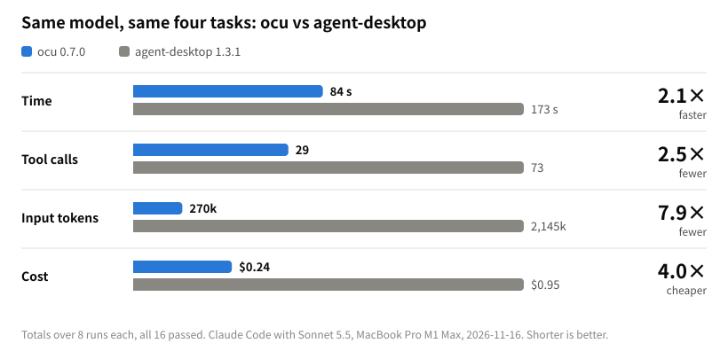
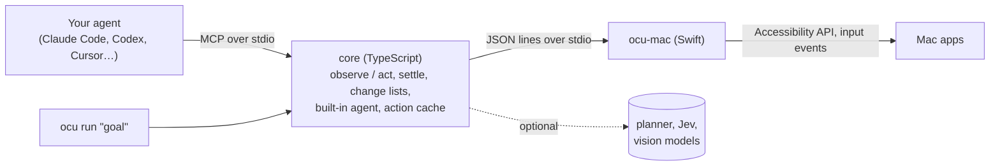

<h1 align="center">open-computer-use</h1>

<p align="center">
  Fast, accessibility-first computer use for macOS.<br>
  Lets any AI agent see and operate Mac apps as text, with screenshots only as a fallback.
</p>

<p align="center">
  <b>English</b> · <a href="README.zh-CN.md">简体中文</a>
</p>

<p align="center">
  <a href="https://github.com/kadaliao/open-computer-use/releases/latest"></a>
  
  <a href="LICENSE"></a>
</p>

---

open-computer-use (`ocu`) reads a Mac app's accessibility tree and shows it to a model as
short lines of text, one per element, each with a ref the model can act on:

    app: TextEdit | window: Untitled
    e112 CheckBox "Bold" [checked]
    e107 PopUpButton "Typeface" = "Helvetica"
    e131 TextArea "hello"

The model presses `e112` instead of guessing pixel coordinates, and each reply tells
it what changed. You can use it in two ways:

- **As an MCP server** for the agent you already use (Claude Code, Codex, Cursor,
  Claude Desktop, DeepSeek Harness…). Your agent does the thinking; ocu needs no model
  key of its own.
- **As a standalone agent**: `ocu run "<goal>"` plans with any OpenAI-compatible model
  (DeepSeek by default).

## Faster and cheaper for your agent

<p align="center">
  <picture>
    <source media="(prefers-color-scheme: dark)" srcset="docs/assets/vs-agent-desktop-en-dark.svg">
    
  </picture>
</p>

With the same model on the same four tasks, an agent using ocu finished in half the time
of one using [agent-desktop](https://github.com/vercel-labs/agent-desktop), with 2.5×
fewer tool calls, 8× fewer input tokens and a quarter of the cost. Both passed every run.
The per-task numbers, the setup and the limits of the test are in
[benchmarks](docs/benchmarks.md).

## Highlights

- **Text, not pixels.** Elements come with their state (`[checked]`, `[selected]`,
  `= "value"`). That is cheap for text-only models, and actions land on exact elements.
- **Replies say what changed.** After an action the reply is `did not change`, only the
  lines that changed, or the full screen when a window or dialog opens. The caller
  doesn't need a separate look.
- **Batches.** Several steps go in one call; between steps that change the screen, ocu
  waits for it to settle. Claude Code computed 789 × 36 on Calculator in 4 turns and 19 s
  with batching, 11 turns and 45 s without.
- **Fast.** A press takes a few milliseconds in the helper and reading a window
  30–130 ms. The built-in agent passes 25 or 26 of its 26 benchmark tasks at about 5 s
  and 3 planner calls each ([benchmarks](docs/benchmarks.md#ocu-on-its-own)).
- **Screenshot fallback.** For canvas apps, games and some Electron apps, a vision model
  can locate and click what the accessibility tree doesn't list. This is optional.
- **Action cache.** The built-in agent saves tasks that worked and replays them, with new
  numbers or quoted text, without calling a model.
- **Small.** A Swift helper and a TypeScript core, shipped as a single binary.

## Requirements

- macOS 13 or later. Release builds are for Apple silicon; on an Intel Mac,
  [build from source](#build-from-source). Day-to-day testing is on macOS 26.
- **Accessibility** permission for the app that runs ocu: your terminal, or the GUI app
  that hosts the MCP server.
- **Screen Recording** permission only for screenshots and the vision fallback.
- A model key only for `ocu run` and the optional vision tools. See
  [configuration](docs/configuration.md).

## Install

With Homebrew:

```sh
brew install kadaliao/tap/ocu
```

Homebrew's copy lives at `/opt/homebrew/opt/ocu/bin/ocu`; use that path as the MCP
command. Or from the release archive:

```sh
gh release download -R kadaliao/open-computer-use -p '*-macos-arm64.tar.gz'
tar xzf ocu-*-macos-arm64.tar.gz
sh ocu-*-macos-arm64/install.sh
```

Without the GitHub CLI, download the archive from the
[latest release](https://github.com/kadaliao/open-computer-use/releases/latest) instead.
The installer puts `ocu` and its helper in `~/.local/share/ocu` (override with
`OCU_HOME`) and links `~/.local/bin/ocu`. Make sure `~/.local/bin` is on your `PATH`.

## Quick start

Check permissions and keys, then look at an app:

```sh
ocu doctor              # permissions, and which model keys answer
ocu observe Calculator  # Calculator's elements, one per line
```

**Use it from your agent.** Register the MCP server, for example in Claude Code:

```sh
claude mcp add ocu -- ~/.local/share/ocu/ocu mcp
```

Then ask your agent something like *"Use ocu to work out 789 × 36 in Calculator."*
For Codex, Cursor, Claude Desktop and DeepSeek Harness, see [MCP setup](docs/mcp.md).

**Or let ocu do it alone:**

```sh
export DEEPSEEK_API_KEY=...
ocu run "Create a new note in Notes that says hello"
```

## How it works



`ocu-mac` reads the accessibility tree, sends input and draws an overlay that shows where
it acts. The core turns what it reads into text, waits for the screen to settle after
each action, works out what changed, and runs the built-in agent.
[Architecture](docs/architecture.md) has the details.

| Command | What it does |
| --- | --- |
| `ocu doctor` | Checks permissions and which planner, Jev and vision keys answer |
| `ocu observe [app]` | Prints an app's elements (the frontmost app if none is named) |
| `ocu mcp` | Runs the MCP server over stdio |
| `ocu run "<goal>" [--no-cache]` | Runs the built-in agent on a goal |
| `ocu cache [clear]` | Lists or clears the action cache |

## Safety and privacy

ocu operates your real desktop with your permissions. A cursor overlay shows where it
acts, and every action is refused while the screen is locked.

- **What leaves your Mac.** In `ocu run`, the screen text goes to the models you
  configured: the planner, and Jev or a fast model if you set one. Screenshots go to the
  vision model, only when the screenshot fallback is used. Under MCP, what your agent
  sees goes wherever your agent sends it.
- **Text on screen can mislead a model.** A web page or a message can contain
  instructions. Give ocu tasks you would be willing to watch, in apps you trust.
- **What stays local can still be private.** `observe` output, screenshots, benchmark
  results and the action cache (`~/.cache/ocu/actions.json`) contain what was on your
  screen. Check them before you paste them into an issue.

## Documentation

| | |
| --- | --- |
| [Concepts](docs/concepts.md) | The screen format, refs, actions, change replies, batches |
| [MCP setup](docs/mcp.md) | Connecting Claude Code, Codex, Cursor, Claude Desktop and DeepSeek Harness, plus the tool reference |
| [Built-in agent](docs/agent.md) | `ocu run`: models, batching, the local finish check, the action cache |
| [Configuration](docs/configuration.md) | Every environment variable, and model choices for planning and vision |
| [Troubleshooting](docs/troubleshooting.md) | Permissions, common errors, known limits |
| [Architecture](docs/architecture.md) | How the helper and the core fit together, and the helper protocol |
| [Benchmarks](docs/benchmarks.md) | The comparison with agent-desktop, ocu's own numbers, and how to measure |
| [Roadmap](docs/roadmap.md) | Where ocu is going, and a plan for each piece of work |
| [Contributing](CONTRIBUTING.md) | Development setup, tests, conventions |
| [Changelog](CHANGELOG.md) | What changed in each version |
| [Security](SECURITY.md) | Reporting a vulnerability |

## Build from source

You need the Xcode command line tools (Swift 5.9 or later) and [Bun](https://bun.sh).

```sh
git clone https://github.com/kadaliao/open-computer-use.git
cd open-computer-use
(cd mac && swift build -c release)
(cd core && bun install)
bun core/src/cli.ts doctor
```

From a checkout, `bun core/src/cli.ts` takes the same commands as `ocu`. To register this
copy as an MCP server: `claude mcp add ocu -- bun /path/to/open-computer-use/core/src/mcp.ts`.
`./scripts/release.sh` builds the single-binary archive; see [releasing](docs/releasing.md).

## Contributing

Bug reports, benchmark tasks, fixes for specific apps and translations are welcome.
Please read [CONTRIBUTING.md](CONTRIBUTING.md) first. Report security problems privately
as described in [SECURITY.md](SECURITY.md).

## License

MIT. See [LICENSE](LICENSE).
