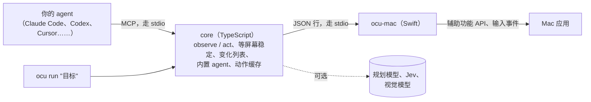

<h1 align="center">open-computer-use</h1>

<p align="center">
  快速、以辅助功能为先的 macOS computer use。<br>
  让任何 AI agent 以文字的形式看到并操作 Mac 应用，截图只作兜底。
</p>

<p align="center">
  <a href="README.md">English</a> · <b>简体中文</b>
</p>

<p align="center">
  <a href="https://github.com/kadaliao/open-computer-use/releases/latest"></a>
  
  <a href="LICENSE"></a>
</p>

---

open-computer-use（`ocu`）读取 Mac 应用的辅助功能树（accessibility tree），把它变成几行简短的文字交给模型。
每个元素一行，每行带一个 ref，模型拿 ref 就能操作这个元素：

    app: 文本编辑 | window: 未命名
    e112 CheckBox "粗体" [checked]
    e107 PopUpButton "字样" = "Helvetica"
    e131 TextArea "hello"

模型直接按 `e112`，不用去猜像素坐标；每次回复都会告诉它屏幕上变了什么。有两种用法：

- **作为 MCP 服务**，接到你正在用的 agent 上（Claude Code、Codex、Cursor、Claude Desktop、
  DeepSeek Harness……）。思考由你的 agent 来做，ocu 自己不需要模型 key。
- **作为独立 agent**：`ocu run "<目标>"` 用任意兼容 OpenAI 接口的模型来规划（默认 DeepSeek）。

## 亮点

- **用文字，不用像素。** 元素带着自己的状态（`[checked]`、`[selected]`、`= "value"`）。
  对纯文本模型来说很省，操作也能准确落到元素上。
- **回复会说明变了什么。** 每次操作后，回复要么是 `did not change`，要么只列出变化的那几行，
  要么在弹出新窗口或对话框时给出整屏。调用方不需要再单独看一次。
- **批量操作。** 一次调用里可以放好几步；在会改变屏幕的步骤之间，ocu 会等屏幕稳定。
  Claude Code 在计算器里算 789 × 36，用批量 4 轮、19 秒；不用批量要 11 轮、45 秒。
- **快。** helper 里一次按下约 3 ms，读一个窗口 25–90 ms。内置 agent 22 个基准任务全部通过，
  每个任务约 4 秒、2 次规划模型调用（[基准测试](docs/benchmarks.zh-CN.md)）。
- **比返回 JSON 树的工具省调用、省 token。** 同一个模型跑同样的四个任务，ocu 0.7.0 用了 84 秒、
  29 次工具调用、27 万输入 token；agent-desktop 1.3.1 用了 173 秒、73 次调用、214.5 万 token。
  两边 8 次都通过（[对比](docs/benchmarks.zh-CN.md#和-agent-desktop-对比)）。
- **截图兜底。** 对画布类应用、游戏和部分 Electron 应用，视觉模型可以定位并点击辅助功能树里没有的东西。
  这一项是可选的。
- **动作缓存。** 内置 agent 会保存成功过的任务，下次换了数字或引号里的文字也能直接重放，不调用模型。
- **小。** 一个 Swift helper 加一个 TypeScript core，发布成单个可执行文件。

## 系统要求

- macOS 13 或更高。发布版只支持 Apple 芯片；Intel Mac 请[从源码构建](#从源码构建)。
  日常测试在 macOS 26 上进行。
- 运行 ocu 的那个应用需要**辅助功能**权限：你的终端，或者承载 MCP 服务的 GUI 应用。
- 只有截图和视觉兜底需要**屏幕录制**权限。
- 只有 `ocu run` 和可选的视觉工具需要模型 key，见[配置](docs/configuration.zh-CN.md)。

## 安装

用 Homebrew：

```sh
brew install kadaliao/tap/ocu
```

Homebrew 装的那份在 `/opt/homebrew/opt/ocu/bin/ocu`，MCP 的 command 就填这个路径。
或者用发布包：

```sh
gh release download -R kadaliao/open-computer-use -p '*-macos-arm64.tar.gz'
tar xzf ocu-*-macos-arm64.tar.gz
sh ocu-*-macos-arm64/install.sh
```

没有装 GitHub CLI 的话，从[最新版本](https://github.com/kadaliao/open-computer-use/releases/latest)页面下载压缩包。
安装脚本会把 `ocu` 和它的 helper 放进 `~/.local/share/ocu`（可以用 `OCU_HOME` 改），
并创建链接 `~/.local/bin/ocu`。确认 `~/.local/bin` 在你的 `PATH` 里。

## 快速上手

先检查权限和 key，再看一个应用：

```sh
ocu doctor              # 检查权限，以及哪些模型 key 能用
ocu observe Calculator  # 列出计算器的元素，每行一个
```

**在你的 agent 里用。** 注册 MCP 服务，比如在 Claude Code 里：

```sh
claude mcp add ocu -- ~/.local/share/ocu/ocu mcp
```

然后对 agent 说类似这样的话：*"用 ocu 在计算器里算 789 × 36。"*
Codex、Cursor、Claude Desktop 和 DeepSeek Harness 的接法见 [MCP 接入](docs/mcp.zh-CN.md)。

**或者让 ocu 自己干：**

```sh
export DEEPSEEK_API_KEY=...
ocu run "新建一条备忘录写 hello"
```

## 工作原理



`ocu-mac` 负责读取辅助功能树、发送输入，并画一层覆盖层，显示它在哪里操作。
core 把读到的内容转成文字，每次操作后等屏幕稳定，算出变了什么，并运行内置 agent。
细节见[架构](docs/architecture.zh-CN.md)。

| 命令 | 作用 |
| --- | --- |
| `ocu doctor` | 检查权限，以及规划模型、Jev 和视觉模型的 key 哪些能用 |
| `ocu observe [app]` | 打印一个应用的元素（不指定时读最前面的应用） |
| `ocu mcp` | 通过 stdio 运行 MCP 服务 |
| `ocu run "<goal>" [--no-cache]` | 让内置 agent 完成一个目标 |
| `ocu cache [clear]` | 列出或清空动作缓存 |

## 安全与隐私

ocu 用你的权限操作你真实的桌面。光标覆盖层会显示它在哪里操作；屏幕锁定时，所有操作都会被拒绝。

- **哪些内容会离开你的 Mac。** `ocu run` 时，屏幕文字会发给你配置的模型：规划模型，
  以及设置了的话 Jev 或快速模型。截图只在用到截图兜底时才发给视觉模型。
  用 MCP 时，你的 agent 看到的内容发往哪里，由你的 agent 决定。
- **屏幕上的文字可能误导模型。** 网页或消息里可能藏着指令。只把你愿意在旁边看着的任务交给 ocu，
  并且只在你信任的应用里用。
- **留在本地的东西也可能是隐私。** `observe` 的输出、截图、基准测试结果和动作缓存
  （`~/.cache/ocu/actions.json`）里都有你屏幕上的内容。贴进 issue 之前先检查一遍。

## 文档

| | |
| --- | --- |
| [概念](docs/concepts.zh-CN.md) | 屏幕格式、ref、操作、变化回复、批量操作 |
| [MCP 接入](docs/mcp.zh-CN.md) | 接入 Claude Code、Codex、Cursor、Claude Desktop 和 DeepSeek Harness，以及工具参考 |
| [内置 agent](docs/agent.zh-CN.md) | `ocu run`：模型、批量、本地完成检查、动作缓存 |
| [配置](docs/configuration.zh-CN.md) | 所有环境变量，以及规划和视觉模型的选择 |
| [故障排查](docs/troubleshooting.zh-CN.md) | 权限、常见错误、已知限制 |
| [架构](docs/architecture.zh-CN.md) | helper 和 core 怎么配合，以及 helper 协议 |
| [基准测试](docs/benchmarks.zh-CN.md) | 怎么测、每个版本的数据，以及和 agent-desktop 的对比 |
| [路线图](docs/roadmap.zh-CN.md) | ocu 接下来往哪走，以及每项工作的计划 |
| [参与贡献](CONTRIBUTING.zh-CN.md) | 开发环境、测试、约定 |
| [更新日志](CHANGELOG.zh-CN.md) | 每个版本改了什么 |
| [安全](SECURITY.md) | 报告漏洞 |

## 从源码构建

需要 Xcode 命令行工具（Swift 5.9 或更高）和 [Bun](https://bun.sh)。

```sh
git clone https://github.com/kadaliao/open-computer-use.git
cd open-computer-use
(cd mac && swift build -c release)
(cd core && bun install)
bun core/src/cli.ts doctor
```

在源码目录里，`bun core/src/cli.ts` 接受和 `ocu` 一样的命令。把这份源码注册成 MCP 服务：
`claude mcp add ocu -- bun /path/to/open-computer-use/core/src/mcp.ts`。
`./scripts/release.sh` 用来构建单文件发布包，见[发布流程](docs/releasing.zh-CN.md)。

## 参与贡献

欢迎提 bug、补充基准任务、修某个具体应用的问题，也欢迎改进翻译。
动手之前请先读 [CONTRIBUTING.zh-CN.md](CONTRIBUTING.zh-CN.md)。安全问题请按 [SECURITY.md](SECURITY.md) 私下报告。

## 许可证

MIT，见 [LICENSE](LICENSE)。
