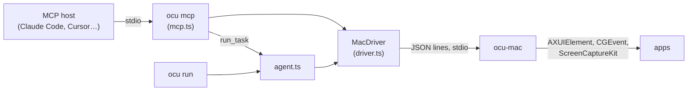

# Architecture

**English** · [简体中文](architecture.zh-CN.md)

How the pieces of ocu fit together. Read this before changing the helper, the screen
format or the agent loop.

- [Layout](#layout)
- [Processes](#processes)
- [The helper protocol](#the-helper-protocol)
- [Core modules](#core-modules)
- [Design rules](#design-rules)
- [Release build](#release-build)

## Layout

```
mac/                     Swift helper (ocu-mac), one file
  Sources/ocu-mac/main.swift
core/                    TypeScript core, run with Bun
  src/
    cli.ts               ocu run / observe / mcp / doctor / cache
    mcp.ts               MCP server: tools, server instructions, key borrowing
    driver.ts            talks to the helper; ref numbering; text rendering of a screen
    screen.ts            settle, change replies, batches (shared by MCP and the agent)
    agent.ts             the built-in agent loop, local finish check, guards
    policy.ts            planner prompt and model tiers (planner, Jev, fast models)
    cache.ts             action cache
    vision.ts            screenshot fallback (locate and ask)
    doctor.ts            ocu doctor
    *.test.ts            unit tests (bun test)
  bench/                 benchmarks (see benchmarks.md)
scripts/
  release.sh             builds dist/ocu-<version>-macos-<arch>.tar.gz
  install.sh             installs a release archive
  check-docs.ts          checks doc pairs and links
docs/                    documentation, English and Chinese
```

## Processes



- `ocu` is one process. It starts one `ocu-mac` child and talks to it over stdin and
  stdout. Under MCP, `run_task` uses the same helper as the other tools, so refs keep
  one numbering.
- The helper has no network listener. Only the process that started it can drive it.
- Accessibility permission belongs to the app at the top of the chain (the terminal or
  the MCP host), which is why that is the app to grant it to.
- When the MCP host closes stdin, the server exits and takes the helper with it.

## The helper protocol

One JSON object per line in each direction. Every request carries an `id`, and the reply
echoes it.

| Request | Reply |
| --- | --- |
| `{"id":1,"cmd":"trust"}` | `{"id":1,"trusted":true}` |
| `{"id":2,"cmd":"observe","app":"Calculator","quiet":false}` | An observation: `{app, window, window_id, sheet?, elements:[{ref, role, label, value?, state?, f?}], others?, error?}` |
| `{"id":3,"cmd":"act","action":"press","ref":"e4"}` | `{ok?, error?, target?, via?, note?}` |
| `{"id":4,"cmd":"screenshot","max":1280}` | `{path, x, y, w, h, px_w, px_h}` or `{error}` |

- `app` is optional and matches the localized name, bundle name or bundle id of a running
  app. `quiet` is a repeat read while waiting for the screen to settle: it neither raises
  the window nor redraws the glow.
- `act` takes the fields of one [action](concepts.md#actions). `find_text` takes
  `query`. `via` says how an action was delivered (accessibility, keyboard, click).
- `screenshot` scales while capturing (ScreenCaptureKit on macOS 14 and later, the
  `screencapture` tool before that) and only shrinks. `x, y, w, h` is the window in
  screen points; `px_w, px_h` is the image size.
- **Ref numbering.** The helper numbers refs from `e1`. `MacDriver` adds 100 on the way
  out and subtracts it on the way in, so callers see refs from `e101`. Planners that
  count lines instead of copying refs used to land one off; refs from `e101` can't pass
  for line numbers. A ref below `e101` reaches the helper as unknown.

The helper also:

- reads several attributes per element in one call, and sets a 1 s timeout per
  accessibility call so a hung app can't block for long;
- refuses every action while the screen is locked;
- removes `ELECTRON_RUN_AS_NODE` from its environment, so Electron apps it opens don't
  start as plain Node and quit when the host itself is an Electron app;
- draws the overlay alongside actions, without holding them up.

## Core modules

- **driver.ts.** `MacDriver` spawns the helper and matches replies to requests by id.
  It turns observations into the text lines models see (`render`), and translates refs.
- **screen.ts.** Logic shared by the MCP server and the agent:
  - `settle` re-reads until the screen is quiet;
  - `describe` chooses between `did not change`, a change list and the full screen;
  - `runSteps` runs a batch.

  The constants in `waits` and `FULL_AFTER` are the knobs. Tests shorten them.
- **agent.ts.** The `ocu run` loop: read, decide, run a batch, settle. It also holds the
  local finish check (`confirmed`, `proofOf`), the summary checks (`unseenClaim`), the
  repeat and ping-pong guards, cache replay, and per-step timing.
- **policy.ts.** The planner's system prompt and `decide`, which starts the planner and
  the Jev judges together and picks a result. Hints for specific apps (Finder's Go menu,
  Safari Reader, calculators) live in the prompt.
- **cache.ts.** Goal patterns with parameters, steps stored by role and label, and the
  rules for when an entry is stored, replayed or dropped.
- **mcp.ts.** Tool definitions, server instructions, the caller's last screen (for change
  replies), and borrowing keys from the login shell.

## Design rules

These choices hold the design together. A change that breaks one needs a good reason
and a benchmark run.

- **Accessibility first, pixels last.** Screenshots are a fallback for what the tree
  doesn't show.
- **Text a small model can follow.** Replies say in words which refs still hold. The
  screen format is short and stable; changing it changes every caller's prompts.
- **Fewer model round trips.** Batches continue past changes when the next steps don't
  depend on the new screen, and a run finishes on local proof. A local finish must never
  accept a weak proof: when in doubt, the planner looks.
- **Measure.** Performance claims come from `bench/`, on a real Mac, before and after.

## Release build

`scripts/release.sh` builds the helper with `swift build -c release`, compiles the core
into a single executable with `bun build --compile`, and packs both with `install.sh`,
the READMEs and the license. At run time the core looks for the helper in `OCU_MAC_BIN`, then next to
its own executable, then in `mac/.build/release/` of a checkout. See
[releasing](releasing.md).
