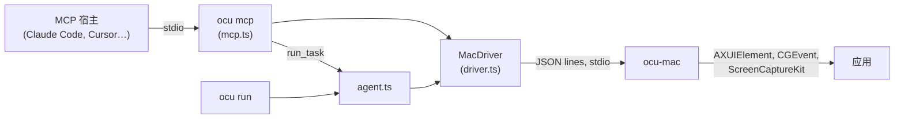

# 架构

[English](architecture.md) · **简体中文**

ocu 的各部分怎么配合。改 helper、屏幕格式或 agent 循环之前，先读这篇。

- [目录结构](#目录结构)
- [进程](#进程)
- [helper 协议](#helper-协议)
- [core 模块](#core-模块)
- [设计原则](#设计原则)
- [发布构建](#发布构建)

## 目录结构

```
mac/                     Swift helper（ocu-mac），只有一个文件
  Sources/ocu-mac/main.swift
core/                    TypeScript core，用 Bun 运行
  src/
    cli.ts               ocu run / observe / mcp / doctor / cache
    mcp.ts               MCP 服务：工具、服务说明、借用 key
    driver.ts            和 helper 通信；ref 编号；把屏幕渲染成文字
    screen.ts            等屏幕稳定、变化回复、批量（MCP 和 agent 共用）
    agent.ts             内置 agent 循环、本地完成检查、防护
    policy.ts            规划模型的提示词和模型分层（规划模型、Jev、快速模型）
    cache.ts             动作缓存
    vision.ts            截图兜底（定位和提问）
    doctor.ts            ocu doctor
    *.test.ts            单元测试（bun test）
  bench/                 基准测试（见 benchmarks.zh-CN.md）
scripts/
  release.sh             构建 dist/ocu-<version>-macos-<arch>.tar.gz
  install.sh             安装发布包
  check-docs.ts          检查文档的中英配对和链接
docs/                    文档，中英文各一份
```

## 进程



- `ocu` 是一个进程。它启动一个 `ocu-mac` 子进程，通过 stdin 和 stdout 和它通信。MCP 下，`run_task` 和其他工具用同一个 helper，所以 ref 只有一套编号。
- helper 不监听网络。只有启动它的那个进程能驱动它。
- 辅助功能权限属于链条最上面的那个应用（终端或 MCP 宿主），所以权限要给它。
- MCP 宿主关掉 stdin 时，服务退出，helper 也跟着退出。

## helper 协议

两个方向都是一行一个 JSON 对象。每个请求带一个 `id`，回复原样带回。

| 请求 | 回复 |
| --- | --- |
| `{"id":1,"cmd":"trust"}` | `{"id":1,"trusted":true}` |
| `{"id":2,"cmd":"observe","app":"Calculator","quiet":false}` | 一次观察：`{app, window, window_id, sheet?, elements:[{ref, role, label, value?, state?, f?}], others?, error?}` |
| `{"id":3,"cmd":"act","action":"press","ref":"e4"}` | `{ok?, error?, target?, via?, note?}` |
| `{"id":4,"cmd":"screenshot","max":1280}` | `{path, x, y, w, h, px_w, px_h}` 或 `{error}` |

- `app` 可选，匹配正在运行的应用的本地化名称、bundle 名称或 bundle id。`quiet` 表示等屏幕稳定时的重复读取：既不把窗口提到前面，也不重画光晕。
- `act` 接受一个[操作](concepts.zh-CN.md#操作)的字段。`find_text` 用的字段是 `query`。`via` 说明这个操作是怎么送达的（辅助功能、键盘、点击）。
- `screenshot` 在截图时就缩放（macOS 14 及以后用 ScreenCaptureKit，之前用 `screencapture` 工具），只缩小不放大。`x, y, w, h` 是窗口在屏幕上的位置和大小，单位是点；`px_w, px_h` 是图片尺寸。
- **ref 编号。** helper 从 `e1` 开始编号。`MacDriver` 往外传时加 100，往里传时减 100，所以调用方看到的 ref 从 `e101` 开始。有些规划模型会去数行号而不是照抄 ref，以前总是差一行；从 `e101` 开始的 ref 不会被当成行号。小于 `e101` 的 ref 传到 helper 时就是未知的。

helper 还会：

- 一次调用读出一个元素的多个属性，并给每次辅助功能调用设 1 秒超时，这样卡住的应用拖不了多久；
- 屏幕锁着时拒绝所有操作；
- 从自己的环境变量里去掉 `ELECTRON_RUN_AS_NODE`。否则宿主本身是 Electron 应用时，它打开的 Electron 应用会当成普通 Node 启动，然后马上退出；
- 和操作同时画覆盖层，不拖慢操作。

## core 模块

- **driver.ts。** `MacDriver` 启动 helper，按 id 把回复和请求对上。它把观察结果转成模型看到的文字行（`render`），并换算 ref。
- **screen.ts。** MCP 服务和 agent 共用的逻辑：
  - `settle` 反复读取，直到屏幕安静下来；
  - `describe` 决定回 `did not change`、变化列表还是整个屏幕；
  - `runSteps` 执行一个批量。

  `waits` 里的常量和 `FULL_AFTER` 是可调的参数。测试里会把它们调短。
- **agent.ts。** `ocu run` 的循环：读屏幕、决策、执行批量、等屏幕稳定。本地完成检查（`confirmed`、`proofOf`）、总结检查（`unseenClaim`）、重复和来回切换的防护、缓存回放以及每步计时也在这里。
- **policy.ts。** 规划模型的系统提示词，以及 `decide`：它同时启动规划模型和 Jev 的判断，再挑一个结果。针对具体应用的提示（访达的「前往」菜单、Safari 阅读器、计算器）写在提示词里。
- **cache.ts。** 带参数的目标模式、按角色和标签存储的步骤，以及一条记录什么时候存、什么时候回放、什么时候丢掉的规则。
- **mcp.ts。** 工具定义、服务说明、调用方上次看到的屏幕（用于变化回复），以及从登录 shell 借 key。

## 设计原则

整个设计靠这几条撑着。要打破其中一条，得有充分的理由，再跑一遍基准测试。

- **辅助功能优先，像素兜底。** 截图只用来补辅助功能树里看不到的东西。
- **小模型也能看懂的文字。** 回复里直接用文字说明哪些 ref 还能用。屏幕格式短而稳定；改它，就等于改了所有调用方的提示词。
- **少跟模型来回。** 后面的步骤不依赖新屏幕时，批量会越过屏幕变化继续执行；有本地证据就直接结束。本地完成绝不能接受站不住的证据：拿不准，就让规划模型看一眼。
- **用数据说话。** 性能结论来自 `bench/`，在真机上测，改动前后都要测。

## 发布构建

`scripts/release.sh` 用 `swift build -c release` 构建 helper，用 `bun build --compile` 把 core 编译成单个可执行文件，再和 `install.sh`、README、许可证一起打包。运行时，core 依次在 `OCU_MAC_BIN`、自己可执行文件的旁边、源码仓库的 `mac/.build/release/` 里找 helper。见[发布流程](releasing.zh-CN.md)。
