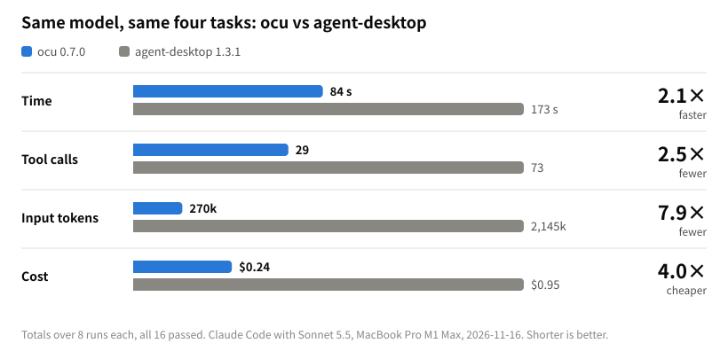

# Benchmarks

**English** · [简体中文](benchmarks.zh-CN.md)

How ocu performs: against another tool, and on its own. Only the latest measurements are
kept here; the [changelog](../CHANGELOG.md) has what each release changed.

- [Compared with agent-desktop](#compared-with-agent-desktop)
- [ocu on its own](#ocu-on-its-own)
- [Running them](#running-them)

## Compared with agent-desktop

The same model drove the same four tasks through ocu's MCP server and through
[agent-desktop](https://github.com/vercel-labs/agent-desktop)'s. Both passed all 8 of
their runs.

<p align="center">
  <picture>
    <source media="(prefers-color-scheme: dark)" srcset="assets/vs-agent-desktop-en-dark.svg">
    
  </picture>
</p>

Per task (medians of two runs):

<table>
  <tr><th>Task</th><th>Tool</th><th align="right">Time</th><th align="right">Tool calls</th><th align="right">Reply characters</th><th align="right">Input tokens</th><th align="right">Cost</th></tr>
  <tr><td rowspan="2">Calculator: 789 × 36</td><td><b>ocu</b></td><td align="right"><b>7.0 s</b></td><td align="right"><b>2</b></td><td align="right"><b>1.3k</b></td><td align="right"><b>16k</b></td><td align="right"><b>$0.023</b></td></tr>
  <tr><td>agent-desktop</td><td align="right">16.4 s</td><td align="right">6</td><td align="right">15k</td><td align="right">129k</td><td align="right">$0.099</td></tr>
  <tr><td rowspan="2">System Settings: open About</td><td><b>ocu</b></td><td align="right"><b>9.8 s</b></td><td align="right"><b>3.5</b></td><td align="right"><b>6.6k</b></td><td align="right"><b>35k</b></td><td align="right"><b>$0.029</b></td></tr>
  <tr><td>agent-desktop</td><td align="right">18.4 s</td><td align="right">6.5</td><td align="right">23k</td><td align="right">208k</td><td align="right">$0.091</td></tr>
  <tr><td rowspan="2">Safari: open a page, click its link</td><td><b>ocu</b></td><td align="right"><b>15.7 s</b></td><td align="right"><b>6</b></td><td align="right"><b>12k</b></td><td align="right"><b>54k</b></td><td align="right"><b>$0.045</b></td></tr>
  <tr><td>agent-desktop</td><td align="right">35.7 s</td><td align="right">17</td><td align="right">54k</td><td align="right">545k</td><td align="right">$0.194</td></tr>
  <tr><td rowspan="2">Finder: Applications > Utilities</td><td><b>ocu</b></td><td align="right"><b>9.4 s</b></td><td align="right"><b>3</b></td><td align="right"><b>6.0k</b></td><td align="right"><b>31k</b></td><td align="right"><b>$0.024</b></td></tr>
  <tr><td>agent-desktop</td><td align="right">16.1 s</td><td align="right">7</td><td align="right">39k</td><td align="right">190k</td><td align="right">$0.093</td></tr>
  <tr><td rowspan="2"><b>All four, 8 runs each (totals)</b></td><td><b>ocu</b></td><td align="right"><b>84 s</b></td><td align="right"><b>29</b></td><td align="right"><b>52k</b></td><td align="right"><b>270k</b></td><td align="right"><b>$0.24</b></td></tr>
  <tr><td>agent-desktop</td><td align="right">173 s</td><td align="right">73</td><td align="right">262k</td><td align="right">2,145k</td><td align="right">$0.95</td></tr>
</table>

**Setup.** 2026-11-16, MacBook Pro (M1 Max, macOS 26.7, English UI).

- **Caller.** Claude Code 2.1.325 in headless mode (`claude -p`) with Sonnet 5.5. No
  built-in tools, no user settings, one MCP server per run. Tool search was off, so all
  of agent-desktop's tools were loaded directly.
- **ocu.** 0.7.0 with model keys removed, so only `observe`, `act` and `screenshot`.
- **agent-desktop.** 1.3.1 with its defaults: 75 tools, headless.
- **Runs.** Each task first resets its app. The outcome was checked on the real screen,
  or in the answer for Calculator. Two rounds, with the order alternating. Costs are API
  prices.

The scripts are in [plans/assets](plans/assets/vs-agent-desktop/).

**Where the gap comes from** (from the call logs):

- **Checking the result.** An ocu `act` reply already shows what changed. After an
  agent-desktop action, the model read again with `snapshot`, `find`, `get` or a
  screenshot (7 screenshots over its 8 runs; ocu needed none).
- **Reply size.** One text line per element, against a JSON tree.
- **Fixed cost per run.** agent-desktop's guide (`skills_get`, about 10k characters) was
  read at the start of every run, and its 75 tool definitions (42k characters) go with
  every request.

**Limits.** Eight runs each, four short tasks, one model, one machine. Three of the tasks
come from ocu's own benchmark, which ocu has been tuned on. agent-desktop works without
taking focus, which this comparison didn't measure. Tool search, harder tasks, Electron
apps and smaller models were not tested. The [roadmap](roadmap.md) lists the follow-ups.

## ocu on its own

Measured with 0.7.1 on 2026-11-16 on a MacBook Pro (M1 Max, macOS 26.7, English UI).

| Helper (`bench/perf.ts`, p50) | |
| --- | --- |
| Read a window: Calculator / Safari / System Settings | 30 / 45 / 118 ms |
| Press, one / six in a row | 7 / 41 ms |
| Key | under 1 ms |

| MCP tool call, as the caller sees it (`bench/mcp-perf.ts`, two runs) | |
| --- | --- |
| One press, with the reply that says what changed | 221–226 ms |
| Batch of 6 presses | 216–233 ms |
| System Settings page change | 531–549 ms |
| Web link, page loaded | 258–382 ms |
| Action with no effect (ocu watches 600 ms for a late change) | 622–661 ms |

| Built-in agent (`bench/run.ts`, 26 tasks, DeepSeek `deepseek-chat`, cache off, two runs) | |
| --- | --- |
| Passed | 25/26, 25/26 |
| Seconds per task | 3.9, 4.7 |
| Planner calls per task | 2.15, 2.54 |
| Time per task: reading the screen / model / waits / actions | 0.9–1.4 / 2.1–2.3 / 0.6 / 0.2–0.4 s |

A different task failed in each run. In one, the agent opened the first of two nested
folders and its `done` was accepted. In the other, the planner made text bold in a
document that was already open instead of writing a new one. The model is about half of
the built-in agent's time.

## Running them

The benchmarks drive real apps on the Mac they run on, so close anything you are working
in first. From `core/`:

```sh
bun bench/run.ts                          # built-in agent, all tasks (Jev + planner)
OCU_JEV=0 bun bench/run.ts planner-only   # planner only; the first argument is a label
bun bench/run.ts smoke notes-new calc-add # selected tasks (or "hard" / "easy")
bun bench/perf.ts <label>                 # the helper alone: observe / act / screenshot times
bun bench/mcp-perf.ts <label>             # MCP tool calls as a caller sees them: time and reply size
```

- **Tasks** are in `core/bench/tasks.ts`. Each one puts an app into a known state, runs
  the goal, and checks the outcome against the real screen, the agent's answer, or a
  shell command. A token unique to each run keeps leftovers from earlier runs from
  faking a pass.
- **Results** are saved to `core/bench/results/`, which git ignores. The summary gives
  pass rate, planner calls per task and the time split: observe, model, waits and
  actions.
- **The action cache** is off unless `OCU_CACHE=1`, so the models are measured, not the
  replays.
- `OCU_SETTLE_LOG=1` prints, for every wait for the screen, how long it took and when the
  change first showed. Use it when tuning the waits in `screen.ts`.
- **The chart** above is drawn by `bun docs/assets/vs-chart.ts`; after a new comparison,
  change the numbers at the top of that file and run it.

When you report numbers, give the machine, the macOS version and the model, and run on a
quiet machine: under load the times are not comparable. Single runs wobble; give the
range of two runs or more. To claim a speed-up, run the previous release on the same
machine the same day.
