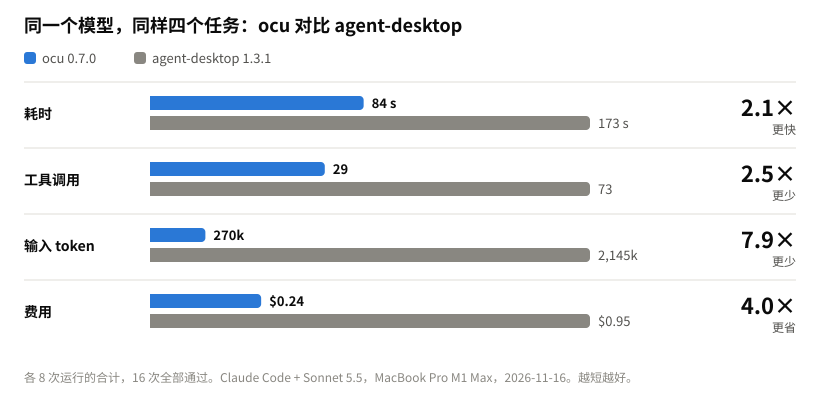

# 基准测试

[English](benchmarks.md) · **简体中文**

ocu 的表现：和别的工具比，以及它自己的数字。这里只保留最新一次测量；每个版本改了什么见[更新日志](../CHANGELOG.zh-CN.md)。

- [和 agent-desktop 对比](#和-agent-desktop-对比)
- [ocu 自己的数字](#ocu-自己的数字)
- [运行方法](#运行方法)

## 和 agent-desktop 对比

让同一个模型分别通过 ocu 和 [agent-desktop](https://github.com/vercel-labs/agent-desktop) 的 MCP 服务做同样的四个任务。两边各 8 次运行，全部通过。

<p align="center">
  <picture>
    <source media="(prefers-color-scheme: dark)" srcset="assets/vs-agent-desktop-zh-dark.svg">
    
  </picture>
</p>

按任务看（两次运行的中位数）：

<table>
  <tr><th>任务</th><th>工具</th><th align="right">耗时</th><th align="right">工具调用</th><th align="right">回复字符</th><th align="right">输入 token</th><th align="right">费用</th></tr>
  <tr><td rowspan="2">计算器：789 × 36</td><td><b>ocu</b></td><td align="right"><b>7.0 s</b></td><td align="right"><b>2</b></td><td align="right"><b>1.3k</b></td><td align="right"><b>16k</b></td><td align="right"><b>$0.023</b></td></tr>
  <tr><td>agent-desktop</td><td align="right">16.4 s</td><td align="right">6</td><td align="right">15k</td><td align="right">129k</td><td align="right">$0.099</td></tr>
  <tr><td rowspan="2">系统设置：打开“关于本机”</td><td><b>ocu</b></td><td align="right"><b>9.8 s</b></td><td align="right"><b>3.5</b></td><td align="right"><b>6.6k</b></td><td align="right"><b>35k</b></td><td align="right"><b>$0.029</b></td></tr>
  <tr><td>agent-desktop</td><td align="right">18.4 s</td><td align="right">6.5</td><td align="right">23k</td><td align="right">208k</td><td align="right">$0.091</td></tr>
  <tr><td rowspan="2">Safari：打开网页并点链接</td><td><b>ocu</b></td><td align="right"><b>15.7 s</b></td><td align="right"><b>6</b></td><td align="right"><b>12k</b></td><td align="right"><b>54k</b></td><td align="right"><b>$0.045</b></td></tr>
  <tr><td>agent-desktop</td><td align="right">35.7 s</td><td align="right">17</td><td align="right">54k</td><td align="right">545k</td><td align="right">$0.194</td></tr>
  <tr><td rowspan="2">访达：应用程序 > 实用工具</td><td><b>ocu</b></td><td align="right"><b>9.4 s</b></td><td align="right"><b>3</b></td><td align="right"><b>6.0k</b></td><td align="right"><b>31k</b></td><td align="right"><b>$0.024</b></td></tr>
  <tr><td>agent-desktop</td><td align="right">16.1 s</td><td align="right">7</td><td align="right">39k</td><td align="right">190k</td><td align="right">$0.093</td></tr>
  <tr><td rowspan="2"><b>四个任务各 8 次运行（合计）</b></td><td><b>ocu</b></td><td align="right"><b>84 s</b></td><td align="right"><b>29</b></td><td align="right"><b>52k</b></td><td align="right"><b>270k</b></td><td align="right"><b>$0.24</b></td></tr>
  <tr><td>agent-desktop</td><td align="right">173 s</td><td align="right">73</td><td align="right">262k</td><td align="right">2,145k</td><td align="right">$0.95</td></tr>
</table>

**测试设置。** 2026-11-16，MacBook Pro（M1 Max，macOS 26.7，英文界面）。

- **调用方。** Claude Code 2.1.325 无头模式（`claude -p`），模型 Sonnet 5.5。不开内置工具，不读用户设置，每次运行只接一个 MCP 服务。关掉了工具搜索，所以 agent-desktop 的工具全部直接加载。
- **ocu。** 0.7.0，去掉了模型 key，只有 `observe`、`act` 和 `screenshot`。
- **agent-desktop。** 1.3.1，默认设置：75 个工具，后台操作。
- **运行方式。** 每个任务开始前先把应用重置。结果在真实屏幕上检查，计算器检查回答。跑两轮，两边交替先后。费用按 API 价格折算。

脚本在 [plans/assets](plans/assets/vs-agent-desktop/)。

**差距从哪来**（看调用记录）：

- **确认结果。** ocu 的 `act` 回复里已经带着屏幕变化。agent-desktop 每次操作后，模型都要再用 `snapshot`、`find`、`get` 或截图读一次（它的 8 次运行里截了 7 张图，ocu 一张没用）。
- **回复大小。** 每个元素一行文字，对比完整的 JSON 树。
- **每次运行的固定开销。** agent-desktop 每次开始都会读一遍使用指南（`skills_get`，约 1 万字符），75 个工具的定义（4.2 万字符）每次请求都要带上。

**局限。** 每边 8 次，四个简单任务，一个模型，一台机器。其中三个任务来自 ocu 自己的基准测试，ocu 在这些任务上调过。agent-desktop 操作时不抢焦点，这次没有测这一项。没测工具搜索、更难的任务、Electron 应用和更小的模型。后续工作见[路线图](roadmap.zh-CN.md)。

## ocu 自己的数字

用 0.6.0 在 Mac mini M2、macOS 26 上测得。0.7 加了 `open` 动作和访达里的文件选中，没有改动这些路径。

| helper（`bench/perf.ts`，p50） | |
| --- | --- |
| 读一个窗口：计算器 / 系统设置 / Safari | 25 / 59 / 86 ms |
| 按一下 / 连按六下 | 3 / 16 ms |
| 按键 | 1 ms |
| 可以交给模型的截图（1280 px） | 117 ms |

| MCP 工具调用，从调用方看（`bench/mcp-perf.ts`，跑两次） | |
| --- | --- |
| 按一下，回复里带着屏幕变化 | 155–182 ms |
| 批量按 6 下 | 143–226 ms |
| 切换系统设置页 | 529–627 ms |
| 网页链接，页面加载完 | 276–486 ms |
| 没有效果的操作（ocu 会盯 600 ms，等迟来的变化） | 640–680 ms |

| 内置 agent（`bench/run.ts`，22 个任务，DeepSeek `deepseek-chat`，缓存关闭，跑两次） | |
| --- | --- |
| 通过 | 22/22、22/22 |
| 每个任务的秒数 | 3.9、4.0 |
| 每个任务的规划模型调用次数 | 2.09、2.23 |
| 每个任务的时间：读屏幕 / 模型 / 等待 / 操作 | 1.1–1.2 / 1.8 / 0.6 / 0.4 s |

内置 agent 的时间里，模型仍然占一半以上。

## 运行方法

基准测试会在本机上操作真实的应用，所以先把手头在用的东西关掉。在 `core/` 下：

```sh
bun bench/run.ts                          # 内置 agent，全部任务（Jev + 规划模型）
OCU_JEV=0 bun bench/run.ts planner-only   # 只用规划模型；第一个参数是标签
bun bench/run.ts smoke notes-new calc-add # 只跑选中的任务（或 "hard" / "easy"）
bun bench/perf.ts <label>                 # 只测 helper：observe / act / screenshot 耗时
bun bench/mcp-perf.ts <label>             # 从调用方角度测 MCP 工具调用：耗时和回复大小
```

- **任务**在 `core/bench/tasks.ts` 里。每个任务先把应用摆到一个已知状态，再执行目标，然后对照真实屏幕、agent 的回答或者一条 shell 命令检查结果。每次运行都带一个唯一的标记，之前运行留下的东西没法冒充通过。
- **结果**存在 `core/bench/results/`，git 会忽略它。汇总里有通过率、每个任务的规划模型调用次数，以及时间拆分：读屏幕、模型、等待和操作。
- **动作缓存**默认关闭，除非设 `OCU_CACHE=1`。这样测的是模型，不是回放。
- `OCU_SETTLE_LOG=1` 会在每次等屏幕稳定时打印用了多久、变化最早什么时候出现。调 `screen.ts` 里的等待时间时用它。
- 上面那张**图**由 `bun docs/assets/vs-chart.ts` 生成；做了新的对比后，改这个文件开头的数字再跑一遍。

报数字时，写清楚机器、macOS 版本和模型，并且在空闲的机器上跑：机器有负载时，耗时没法比较。单次结果会有波动，至少跑两次，给出范围。要说明提速，就在同一台机器、同一天把上一个版本也跑一遍。
